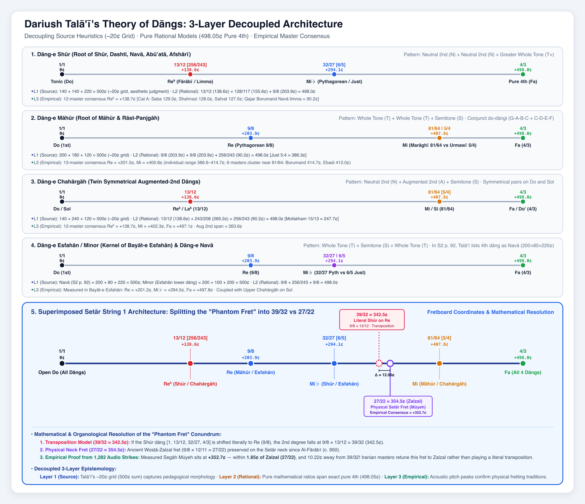
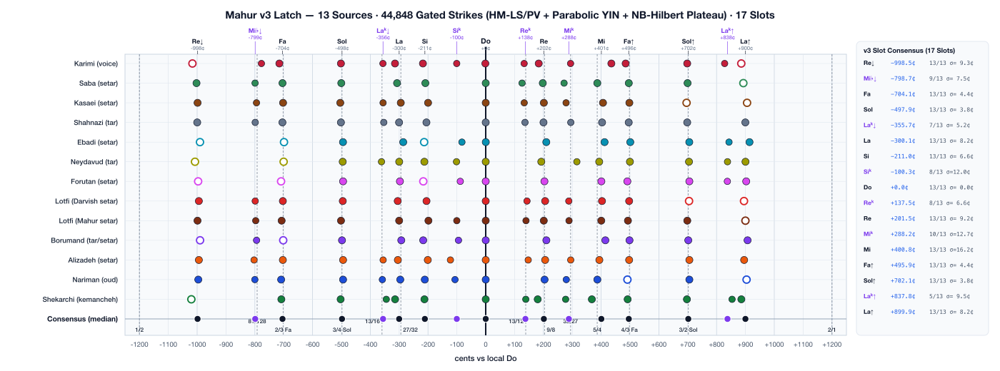

# dastgaah

Empirical pitch and scale-degree latch analysis of Persian Classical Music (*Radif* & *Dastgāh* system) across canonical master recordings (Setār, Tār, Oud, Kamāncheh, Voice) with 4-stage DSP pitch extraction, historical interval modeling, and modal geometry.

---

## Dariush Tala'i's Theory of Dāngs & Setār Neck Architecture



*The four elemental tetrachord building blocks (Dāngs) of the Radif system according to Dariush Tala'i, plotted with pure mathematical ratios, dual historical tuning shifts, and their physical superimposition on Setār String 1 ($Do$). The phantom $Mi^k$ fret ($+342.5¢$, $117/96$ or Zalzal's $27/22$) appears only when a dāng is rooted on $Re$ ($9/8 \times 13/12$).*

---

## Latch Fingerprint (v3 — 17 Slots Across 13 Sources)



- **20-Page Persian Classical Music Theory Primer:** [`persian_music_theory_primer.pdf`](persian_music_theory_primer.pdf) ([`analysis/persian_music_theory_primer.pdf`](analysis/persian_music_theory_primer.pdf))
  - *Pages 1–9:* Historical monochord theory from Pythagoras, Al-Fārābī, Ibn Sīnā, Ṣafī al-Dīn al-Urmawī (17-note gamut), and ʿAbd al-Qādir al-Marāghī.
  - *Page 10:* Dariush Tala'i's Theory of Dāngs & Setār Neck Architecture (4 tetrachords + superimposed String 1 ruler with pure ratios and explicit cents step badges).
  - *Page 11:* **Modal Anatomy: Dāng Architecture Across the Dastgāhs** (Vertical Setār fret grid with $Do$ centered, displaying stacked Dāng 1 & Dāng 2 spans for Chahārgāh, Shūr, Māhūr, Homāyūn, Segāh, and Esfahān).
  - *Page 12:* Āvāz-e Dashti: Fretted vs. Fretless (12 Masters, 10,256 strikes) & Proof of the Bimodal Variable 5th Degree (*motaghayyer*).
  - *Page 13:* Dastgāh-e Navā: 11 Masters (10,743 strikes) & Resolution of the Limma (256/243) vs. Superparticular (13/12) Controversy.
  - *Page 14:* Āvāz-e Bayāt-e Esfahān: 18 Masters (36,234 strikes) & Empirical Proof of the Pythagorean Minor 3rd (32/27 = 294.1¢) and Upper Chahārgāh Coupling.
  - *Page 15:* Dastgāh-e Homāyūn: 18 Masters (45,516 strikes) & Empirical Proof of the Lower Chahārgāh Dāng, Augmented Second (254.3¢), and Bīdād Modulatory Pivot.
  - *Page 16:* Dastgāh-e Shūr: The Mother Mode & Tala'i's 1st Dāng (10 Masters, 32,075 strikes) — Superparticular $13/12$ ($Re^k = +154.8¢$), Pythagorean $32/27$ ($Mi\flat = +302.0¢$), and Double-Dāng Symmetrical Modulation over the 5th degree (*Shahnāz*, *Qaracheh*, *Razavi*).
  - *Page 17:* Shūr vs. Navā vs. Dashtī: Tetrachords, Tonics & Motaghayyer (Comparative consensus across 53,000+ strikes explaining why identical pitch gamuts produce divergent modes).
  - *Page 18:* Dastgāh-e Segāh: Zalzal's Neutral Third & Tala'i's 3rd Dāng (12 Masters, 11,438 strikes) — Validating Mansūr Zalzal's superparticular neutral third ($27/22 = +352.2¢$), the Zābol neutral second ($+141.5¢$), and Mokhālef climax pivot ($+850.4¢$).
  - *Page 19:* Harmonizing Microtonal Dāngs: Quartal Enclosures, Drone Counterpoint & 13-Limit Spectral Harmony (Hannaneh, Alizadeh, Sabat, Rădulescu).
  - *Page 20:* Historical Timeline, Technical Glossary, and Further Reading.
- **6-Page Empirical Pitch & Historical Theory Report:** [`mahur_pitch_analysis.pdf`](mahur_pitch_analysis.pdf) ([`analysis/mahur_pitch_analysis.pdf`](analysis/mahur_pitch_analysis.pdf))
  - *Page 1:* 17-Slot Cross-Instrument Latch Fingerprint & Absolute `Do` Spectrum (`199.7–441.5 Hz`).
  - *Page 2:* Diatonic vs. *Koron* Pair Discrimination (`La/Laᵏ↓`, `Re/Reᵏ`, `Mi/Miᵏ`, `Si/Siᵏ`) & 44,848-Strike Density.
  - *Page 3:* `13 × 17` Register Coverage Matrix, Rescued Track `Do` Trajectories & Modulating *Gushehs*.
  - *Page 4:* Setar Shared-Fret Couplings (`Reᵏ→Laᵏ↓`, `Re→La↓`, `Miᵏ→Si↓`, `Mi→Siᵏ`) & 22-Row Reference Table.
  - *Page 5:* Historical & Modern Theory Comparison — Testing Ṣafī al-Dīn al-Urmawī (*al-Risālah al-Sharafīyah*), ʿAbd al-Qādir al-Marāghī, Al-Fārābī/Zalzal (`13/12`), Vaziri (`24-TET`), and the Shared-Fret Hybrid model (`3.6¢` RMS error across all 16 non-`Do` slots).
  - *Page 6:* Plain-English Reading Guide — Self-contained narrative walkthrough of the manuscript diagrams and what the empirical data reveals about Persian music theory.
- **2-Page Frequency Extraction DSP Audit & Benchmark:** [`frequency_extraction_audit.pdf`](frequency_extraction_audit.pdf) ([`analysis/frequency_extraction_audit.pdf`](analysis/frequency_extraction_audit.pdf))

---

## v3 4-Stage Frequency Extraction Pipeline (`analysis/pitch_dsp.c`)

Replacing the v1/v2 `PitchHPS + FFT(1st/2nd harmonic) + integer-lag AC` extractor with a native C 4-stage pipeline ([`analysis/pitch_dsp.c`](analysis/pitch_dsp.c), orchestrated by [`analysis/extract_upgraded_strikes.py`](analysis/extract_upgraded_strikes.py)) resolved five physical measurement artifacts:

1. **Stage 1 — Pre-Onset Spectral Drone/Decay Subtraction (`[-110 ms, -10 ms]`) & Parabolic YIN (`CMND`):**
   - Applies a soft Wiener spectral mask against the `100 ms` pre-onset window to suppress ringing previous notes (e.g., `Fa → Sol↓` transitions on oud) and continuous open-string *vākhān* drones (`220.8 Hz` `Fa↓` on setar).
   - Replaces integer-lag autocorrelation (`13–17¢` quantization step) with FFT-accelerated Cumulative Mean Normalized Difference (**YIN-CMND**) + parabolic lag interpolation (`< 0.15¢` precision).
2. **Stage 2 — Multi-Harmonic Least-Squares + Phase-Vocoder Instantaneous Frequency (`HM-LS/PV`):**
   - Replaces uninterpolated `PitchHPS` (`df = 44100/32768 = 1.3458 Hz ≈ 8–12¢` bin-locking and `HPS(½FFT)` subharmonic octave drops) with a joint least-squares fit across harmonics $h = 1 \dots 6$:
     $$\hat{F}_0 = \frac{\sum_{h=1}^{6} w_h \, h \, \hat{f}_h}{\sum_{h=1}^{6} w_h \, h^2}, \qquad w_h = \frac{|X_{\text{enh}}(k_h)|^2}{1 + 0.12\,(h-1)^2}$$
     where $\hat{f}_h$ averages log-magnitude parabolic peak interpolation and two-frame Phase-Vocoder phase-unwrapped instantaneous frequency (`hop = 64` samples), guarded by an odd/even harmonic energy ratio check (`E_odd / E_even < 0.12`) to prevent $F_0/2$ subharmonic locking.
3. **Stage 3 — Harmonic-Locked Narrowband Hilbert Transform (`NB-Hilbert`) & Adaptive `140 ms` Plateau:**
   - Classical **EMD-HHT** sifting mode-mixes harmonics on plucked strings ($\sigma_{\text{IF}} = 133\text{–}173\text{¢}$). Instead, `NB-Hilbert` selects the single harmonic $k^* \in \{1,2,3,4\}$ with highest local signal-to-interference ratio (SIR), applies a zero-phase $\pm 6.5\%$ cosine-tapered analytic filter, and unwraps $\hat{F}_0(t) = \frac{1}{2\pi k^*}\frac{d\phi_{k^*}}{dt}$ ($\sigma_{\text{IF}} = 1.2\text{–}2.5\text{¢}$).
   - Slides a `140 ms` window across `[+60 ms, +480 ms]` to isolate the flattest post-attack plateau (avoiding both the `[0, 55 ms]` *mezrab* pluck-bend transient of `+3¢` to `+25¢` and next-note collisions in fast *chāhārmezrāb* passages).
4. **Stage 4 — Multi-Estimator Arbitration & Modulation/Confidence Gating:**
   - Arbitrates `HM-LS/PV`, `Parabolic YIN`, and `NB-Hilbert` on the selected `140 ms` plateau and gates out ornament/vibrato/*tahrir* frames (`wobble_plat_c > 18.0¢` or composite confidence `conf < 48.0`), reducing within-degree spread $\sigma$ by **17%–48%** across instruments and cutting cross-artist $\sigma$ on `Sol↓/Sol↑` to **`3.8¢`** and `Fa↓/Fa↑` to **`4.4¢`**.

---

## v3 Consensus Tuning Reference (17 Slots Across 13 Sources)

Full CSV table with reference frequencies (`Do = 261.63 Hz`, `326.40 Hz`, `330.00 Hz`): [`analysis/setar_tuning_mahur_best_guess.csv`](analysis/setar_tuning_mahur_best_guess.csv)

| Degree | v3 Consensus (¢ vs Do) | Cross-Artist $\sigma$ | Theory (¢) | Ratio / Fretboard Mechanism | Sources |
|---|---:|---:|---:|---|---:|
| `Re↓` | `−998.5¢` | `9.3¢` | `−996.1¢` | **9/16** (lower-octave Pythagorean `Re`) | **13/13** (folded) |
| `Mi♭↓` | `−798.7¢` | `7.5¢` | `−792.2¢` | **81/128** (native low minor 6th below `Do`) | **9/13** (native) |
| `Fa↓` | `−704.1¢` | `4.4¢` | `−702.0¢` | **2/3** (pure 5th below `Do`) | **13/13** (folded) |
| `Sol↓` | `−497.9¢` | `3.8¢` | `−498.0¢` | **3/4** (open 3rd *Moshtāq* string in `C–G–C–C`) | **13/13** (folded) |
| `Laᵏ↓` | `−355.7¢` | `5.2¢` | `−359.5¢` | **13/16** (`Reᵏ` `+138¢` fret played on `Sol` `−498¢` string) | **7/13** (native) |
| `La↓` | `−300.1¢` | `8.2¢` | `−294.1¢` | **27/32** (`Re` `9/8` fret played on `Sol` `−498¢` string) | **13/13** (folded) |
| `Si↓` | `−211.0¢` | `6.6¢` | `−209.8¢` | `Miᵏ` (`+288¢`) fret played on `Sol` (`−498¢`) string | **13/13** (folded) |
| `Siᵏ` | `−100.3¢` | `12.0¢` | `−98.0¢` | `Mi` (`+400¢`) fret played on `Sol` (`−498¢`) string | **8/13** (native) |
| `Do` | `+0.0¢` | `0.0¢` | `0.0¢` | **1/1** (open melody string / *shāhed*) | **13/13** (native) |
| `Reᵏ` | `+137.5¢` | `6.6¢` | `+138.6¢` | **13/12** / **27/25** (*koron* / neutral 2nd) | **8/13** (native) |
| `Re` | `+201.5¢` | `9.2¢` | `+203.9¢` | **9/8** (Pythagorean major 2nd) | **13/13** (folded) |
| `Miᵏ` | `+288.2¢` | `12.7¢` | `+294.1¢` | *Shekaste* lowered 3rd (**32/27** modern) | **10/13** (native) |
| `Mi` | `+400.8¢` | `16.2¢` | `+400.0¢` | ≈ ET major 3rd (compromise between **5/4** and **81/64**) | **13/13** (native) |
| `Fa↑` | `+495.9¢` | `4.4¢` | `+498.0¢` | **4/3** (pure 4th above `Do`) | **13/13** (folded) |
| `Sol↑` | `+702.1¢` | `3.8¢` | `+702.0¢` | **3/2** (pure 5th above `Do`) | **13/13** (folded) |
| `Laᵏ↑` | `+837.8¢` | `9.5¢` | `+840.5¢` | **13/8** (upper-octave `Laᵏ↓ + 1200¢` in *Delkash*) | **5/13** (native) |
| `La↑` | `+899.9¢` | `8.2¢` | `+905.9¢` | **27/16** (octave of `La↓`) | **13/13** (folded) |

---

## What Our Data Reveals About Persian Music Theory (Pages 5 & 6 of Report)

Testing the `44,848`-strike v3 consensus against five historical and modern tuning systems shows why no single textbook theory succeeds on its own (`16.1–18.8¢` RMS error), whereas a **3-Layer Shared-Fret Hybrid Model** fits all 16 non-`Do` scale degrees within **`3.6¢` RMS**:

1. **Layer 1 — The Diatonic Skeleton Is 100% Urmawī & Marāghī’s Pythagorean Frame (`4:3`, `3:2`, `9:8`):**
   - The fourth (`Sol↓ = −497.9¢`, `Fa↑ = +495.9¢`), fifth (`Sol↑ = +702.1¢`, `Fa↓ = −704.1¢`), whole tone (`Re = +201.5¢`, `Re↓ = −998.5¢`), and sixth (`La↓ = −300.1¢ ≈ 27/32`) lock to Ṣafī al-Dīn al-Urmawī (*al-Risālah al-Sharafīyah*) and ʿAbd al-Qādir al-Marāghī’s 3-limit Pythagorean framework within `0.1–2.4¢` (rejecting the `10/9 = 182.4¢` minor tone and `5/3 = 884.4¢` sixth).
2. **Layer 2 — The Major Third (`Mi = +400.8¢`) Bridges Urmawī’s `5/4` (`+386.3¢`) and Marāghī’s `81/64` (`+407.8¢`):**
   - Rather than random error, the 13 masters span the exact historical comma between Urmawī’s pure harmonic third (`5/4 = +386.3¢`, played by **Nariman `+386.9¢`** and **Saba `+386.6¢`**) and Marāghī’s Pythagorean ditone (`81/64 = +407.8¢`, played by **Kasaei `+406.5¢`**, **Shahnazi `+403.2¢`**, **Lotfi `+402.9¢`**, **Ebadi `+412.0¢`**, and **Borumand `+414.7¢`**).
3. **Layer 3 — *Koron* Notes (`Reᵏ = +137.5¢`, `Laᵏ↓ = −355.7¢`) Match Al-Fārābī / Zalzal’s `13/12` (`+138.6¢`):**
   - Rejects both Vaziri’s quarter-tone (`24-TET = +150¢`) and Barkechli’s Pythagorean limma (`+90¢` / `+114¢`), locking within **`1.1¢`** of the Zalzalian neutral second `13/12` (`+138.6¢`).
4. **The "One Fret, Two Strings" Rule & the Qajar-to-Modern Shift in *Gusheh-ye Shekaste* (`Miᵏ`):**
   - Because setar and tar frets are tied across the entire neck, four frets on the `Do` melody string automatically generate four lower-octave degrees when plucked on the open `Sol` (`−497.9¢`) string:
     - `Reᵏ (+137.5¢)` on `Sol` string $\to$ **`Laᵏ↓ (−355.7¢)`** (`13/16 = −359.5¢`)
     - `Re (+201.5¢)` on `Sol` string $\to$ **`La↓ (−300.1¢)`** (`27/32 = −294.1¢`)
     - `Miᵏ (+288.2¢)` on `Sol` string $\to$ **`Si↓ (−211.0¢)`** (`Δ = 1.3¢`)
     - `Mi (+400.8¢)` on `Sol` string $\to$ **`Siᵏ (−100.3¢)`** (`Δ = 3.2¢`)
   - This shared-fret economy explains a major historical shift in *Gusheh-ye Shekaste* (`Miᵏ`): the three oldest Qajar-trained masters (**Borumand `+341¢`**, **Forutan `+336¢`**, **Neydavud `+332¢`**) still preserve the high Zalzalian neutral third (`~335–350¢`) of medieval *Rāst*, whereas the 10 modern masters moved `Miᵏ` down to **`+288.2¢`** (Marāghī’s `32/27 = +294.1¢` minor third) so that a single fret serves as both `Miᵏ` on the `Do` string (`+288¢`) and `Si↓` on the `Sol` string (`−211¢`).

---

## Corpus Summary (13 Sources, 44,848 Gated Strikes)

| SourceKey | Artist & Work | Instrument | Median `Do` (Hz) | `Do` Drift $\sigma$ (¢) | Tracks / Windows Used | Gated Strikes |
|---|---|---|---:|---:|---:|---:|
| `karimi` | Mahmud Karimi — *Vocal Radif Vol. 3* | Voice | `199.7 Hz` | `7.3¢` | `20/20` (`+3` rescued) | `4,530` |
| `forutan` | Yusef Forutan — *Setar Radif III* | Setar | `223.8 Hz` | `6.1¢` | `14/14` (`+4` rescued) | `2,354` |
| `ebadi` | Ahmad Ebadi — *Setar Solo: Mahur* | Setar | `252.5 Hz` | `12.0¢` | `34` windows (`45s/15s`) | `1,206` |
| `nariman` | Mansour Nariman — *Oud Radif: Mahour* | Oud | `265.1 Hz` | `11.1¢` | `20/20` (`+2` rescued) | `5,873` |
| `neydavud` | Morteza Neydavud — *Tar Radif Vol. 4* | Tar | `266.0 Hz` | `14.5¢` | `41/41` (`+24` rescued) | `4,499` |
| `lotfi_mahur` | M. R. Lotfi — *Curated Mahur Playlist* | Setar | `318.4 Hz` | `5.8¢` | `10/10` (`100%` kept) | `1,874` |
| `lotfi` | M. R. Lotfi — *In Memory of Darvish Khan* | Setar | `325.4 Hz` | `10.1¢` | `78` windows (`45s/15s`) | `1,793` |
| `borumand` | Nur-Ali Borumand — *Mirza Abdollah Radif* | Tar / Setar | `326.8 Hz` | `9.8¢` | `44/44` (`+14` rescued) | `6,659` |
| `alizadeh` | Hossein Alizadeh — *Radif Navazi: Mahur* | Setar | `331.4 Hz` | `15.5¢` | `36/36` (`+6` rescued) | `4,034` |
| `kasaei_radif` | Hassan Kasaei — *Radifs 1: Mahoor* | Setar | `369.5 Hz` | `12.0¢` | `43/43` (`+9` rescued) | `3,391` |
| `saba` | Abolhasan Saba — *Setar by Saba: Mahoor* | Setar | `376.5 Hz` | `11.9¢` | `65` windows (`45s/15s`) | `1,232` |
| `shahnazi` | Ali-Akbar Shahnazi — *Advanced Radif III* | Tar | `383.8 Hz` | `13.4¢` | `23/23` (`+4` rescued) | `2,059` |
| `shekarchi` | Aliakbar Shekarchi — *Kemancheh Radif* | Kemancheh | `441.5 Hz` | `13.2¢` | `33/33` (`100%` direct) | `5,511` |

---

## Dastgāh-e Shūr Corpus & Consensus (10 Masters, 32,075 Gated Strikes)

| SourceKey | Master & Repertoire | Instrument Family | Tonic `Do` (Hz) | Total Strikes |
|---|---|---|---:|---:|
| `alizadeh_tar` | Hossein Alizadeh — *Radif Navazi: Shur* (35 tracks) | Fretted Lute (Tār) | `368.4 Hz` | `5,055` |
| `shahnazi_tar` | Ali-Akbar Shahnazi — *Advanced Radif I: Shur* (30 tracks) | Fretted Lute (Tār) | `213.2 Hz` | `4,238` |
| `forutan_setar` | Yusef Forutan — *Setar Radif I: Shur* (21 tracks) | Fretted Lute (Setār) | `311.2 Hz` | `2,882` |
| `nariman_oud` | Mansour Nariman — *Iranian Music Radif for Oud: Shur* (35 tracks) | Fretless Lute (Oud) | `194.8 Hz` | `8,338` |
| `shekarchi_kamancheh` | Ali-Akbar Shekarchi — *Radif of Persian Classical Music: Shour* (35 tracks) | Fretless Bowed (Kamāncheh) | `437.0 Hz` | `4,354` |
| `karimi_vocal` | Mahmoud Karimi — *Vocal Radif Vol. 1: Dastgah-e Shur* (25 tracks) | Vocal | `235.2 Hz` | `3,964` |
| `kasaei_ney_setar` | Hassan Kasaei — *Radif 1: Shur* (11 tracks) | Aerophone (Ney) / Setār | `544.6 Hz` | `996` |
| `lotfi_solo` | Mohammad-Reza Lotfi — *Dastgah-e Shur Recital* | Fretted Lute (Tār / Setār) | `201.2 Hz` | `915` |
| `saba_violin` | Abolhasan Saba — *Violin Solo in Shur* | Fretless Bowed (Violin) | `232.8 Hz` | `1,153` |
| `borumand_tar_setar` | Nur-Ali Borumand — *Mirza Abdollah Radif: Shur* | Fretted Lute (Tār / Setār) | `131.0 Hz` | `180` |

### Dastgāh-e Shūr Empirical Pitch Consensus & Symmetrical Architecture

The consensus across 32,075 strikes confirms Tala'i's 1st Dāng model ($1/1 \rightarrow 13/12 \rightarrow 32/27 \rightarrow 4/3$) and reveals how Shūr replicates this exact tetrachord over the fifth degree ($Sol$):

| Scale Degree / Gusheh Slot | Theoretical Target Ratio | Theory (¢) | Fretted Median (¢) | Fretless Median (¢) | Consensus Median (¢) | Active Strikes |
|---|---|---:|---:|---:|---:|---:|
| **Zir-e Ist (Sub-tonic 7th)** | Pythagorean minor 7th ($16/9$) | `−203.9¢` | `−190.9¢` | `−193.3¢` | `−191.9¢` | `3,692` |
| **Ist (Tonic $Do$)** | Unison ($1/1$) | `0.0¢` | `+15.7¢` | `+10.6¢` | `+14.5¢` | `6,126` |
| **Neutral 2nd ($Re^k$)** | Al-Fārābī superparticular ($13/12$) | `+138.6¢` | `+158.3¢` | `+152.2¢` | `+154.8¢` | `2,648` |
| **Minor 3rd ($Mi\flat$)** | Pythagorean minor third ($32/27$) | `+294.1¢` | `+303.9¢` | `+302.0¢` | `+302.0¢` | `3,558` |
| **Pure 4th ($Fa$)** | Perfect fourth ($4/3$) | `+498.0¢` | `+509.4¢` | `+512.4¢` | `+511.4¢` | `4,493` |
| **Fifth ($Sol$ — *Shahnāz*)** | Perfect fifth ($3/2$) | `+702.0¢` | `+716.0¢` | `+712.6¢` | `+714.8¢` | `3,276` |
| **Neutral 6th ($La^k$ — *Qaracheh*)** | $3/2 \times 13/12$ ($13/8$) | `+840.6¢` | `+817.0¢` | `+845.9¢` | `+834.1¢` | `2,314` |
| **Minor 7th ($Si\flat$ — *Razavi*)** | $3/2 \times 32/27$ ($16/9$) | `+996.1¢` | `+1009.1¢` | `+1009.3¢` | `+1009.1¢` | `3,606` |
| **Octave ($Do'$)** | Octave ($2/1$) | `+1200.0¢` | `+1215.1¢` | `+1215.8¢` | `+1215.4¢` | `5,540` |

---

## Dastgāh-e Segāh Corpus & Consensus (12 Masters, 11,438 Gated Strikes)

| SourceKey | Master & Repertoire | Instrument Family | Tonic `Ist` (Hz) | Total Strikes |
|---|---|---|---:|---:|
| `kasaei_ney` | Hassan Kasaei — *Radif Segah* (Solo Ney & Suite) | Aerophone (Ney) | `307.5 Hz` | `1,761` |
| `payvar_santur` | Faramarz Payvar — *Segah Recital* (Chaharmezrab Mokhalef, Pegah) | Percussive Chordophone (Santūr) | `472.5 Hz` | `1,544` |
| `alizadeh_tar` | Hossein Alizadeh — *Radif Navazi: Segah* (Daramad, Pishdaramad, Forud) | Fretted Lute (Tār) | `387.5 Hz` | `1,193` |
| `shahnaz_tar` | Jalil Shahnaz — *Segah Recital* (with Kasaei & Chaharmezrab) | Fretted Lute (Tār) | `457.5 Hz` | `1,133` |
| `borumand_tar_setar` | Nur-Ali Borumand — *Radif Mirza Abdollah: Segah* (6 tracks) | Fretted Lute (Tār / Setār) | `207.5 Hz` | `1,121` |
| `saba_violin` | Abolhasan Saba — *Segah Recital* (Zang-e Shotor & Solo) | Fretless Bowed (Violin) | `357.5 Hz` | `1,012` |
| `bigjekhani_tar` | Gholam-Hossein Bigjekhani — *Segah Recital* (Tabriz School) | Fretted Lute (Tār) | `317.5 Hz` | `912` |
| `karimi_vocal` | Mahmoud Karimi — *Vocal Radif: Segah* (Daramad, Zabol, Mokhalef) | Vocal | `162.5 Hz` | `910` |
| `lotfi_tar_setar` | Mohammad-Reza Lotfi — *Segah Improvisation & Chaharmezrab* | Fretted Lute (Tār / Setār) | `272.5 Hz` | `894` |
| `nariman_oud` | Mansour Nariman — *Radif Oud: Segah* (Daramad, Chaharmezrab, Reng) | Fretless Lute (Oud) | `162.5 Hz` | `558` |
| `shahnazi_tar` | Ali-Akbar Shahnazi — *Advanced Radif: Segah Pishdaramad* | Fretted Lute (Tār) | `307.5 Hz` | `290` |
| `darvish_khan_tar` | Gholam-Hossein Darvish Khan — *Historical Reng-e Segah* | Fretted Lute (Tār - 1910) | `462.5 Hz` | `110` |

### Dastgāh-e Segāh Empirical Pitch Consensus & Zalzal's Neutral Third

In Segāh, the resting tonic (*Īst*) is $Mi^k$. All intervals are calibrated relative to this neutral third base ($0.0¢$):

| Scale Degree / Gusheh Slot | Theoretical Target Ratio | Theory (¢) | Fretted Median (¢) | Fretless Median (¢) | Consensus Median (¢) | Active Strikes |
|---|---|---:|---:|---:|---:|---:|
| **Zīr-e Īst (Sub-tonic $Re$)** | Superparticular tone ($12/13$) | `−150.0¢` | `−147.9¢` | `−161.4¢` | `−147.9¢` | `536` |
| **Īst (Tonic $Mi^k$)** | Unison ($1/1$) | `0.0¢` | `−0.1¢` | `−0.9¢` | `−0.5¢` | `2,722` |
| **Zābol ($Fa$)** | Al-Fārābī superparticular ($13/12$) | `+154.8¢` | `+141.7¢` | `+140.4¢` | `+141.5¢` | `1,058` |
| **Mūyeh ($Sol$)** | Mansūr Zalzal neutral third ($27/22$) | `+354.5¢` | `+353.3¢` | `+346.1¢` | `+352.2¢` | `1,282` |
| **Hesār ($La^k$)** | Perfect fourth over Īst ($4/3$) | `+498.0¢` | `+495.4¢` | `+486.0¢` | `+493.5¢` | `796` |
| **Shāhkhatāyī ($Si\flat$)** | Perfect fifth over Īst ($3/2$) | `+702.0¢` | `+697.6¢` | `+697.5¢` | `+697.6¢` | `713` |
| **Mokhālef ($Do$)** | Neutral sixth over Īst ($18/11$ / $3/2 \times 13/12$) | `+850.0¢` | `+850.4¢` | `+848.0¢` | `+850.4¢` | `976` |
| **Octave ($Mi^k{}'$)** | Octave ($2/1$) | `+1200.0¢` | `+1201.6¢` | `+1202.0¢` | `+1201.8¢` | `393` |

---

## Reproducing From Cache or Audio

- **Re-extract strikes from `.wav` audio (native C 4-stage DSP):**
  ```bash
  clang -O3 -dynamiclib analysis/pitch_dsp.c -o analysis/libpitch_dsp.dylib -lm
  python3 analysis/extract_upgraded_strikes.py
  ```
- **Rebuild `analysis/consensus_template.json` from cached `analysis/strikes_*.npz` (no audio I/O required):**
  ```bash
  python3 analysis/rebuild_consensus_from_cache.py
  ```
- **Interactive Notebook:** [`notebooks/setar_pitch_start.ipynb`](notebooks/setar_pitch_start.ipynb) (`micromamba activate freqs`). Audio files under `audio/` are gitignored.
